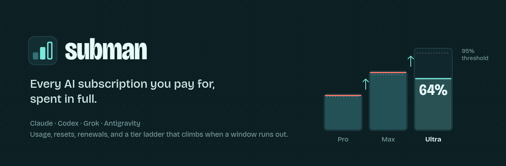
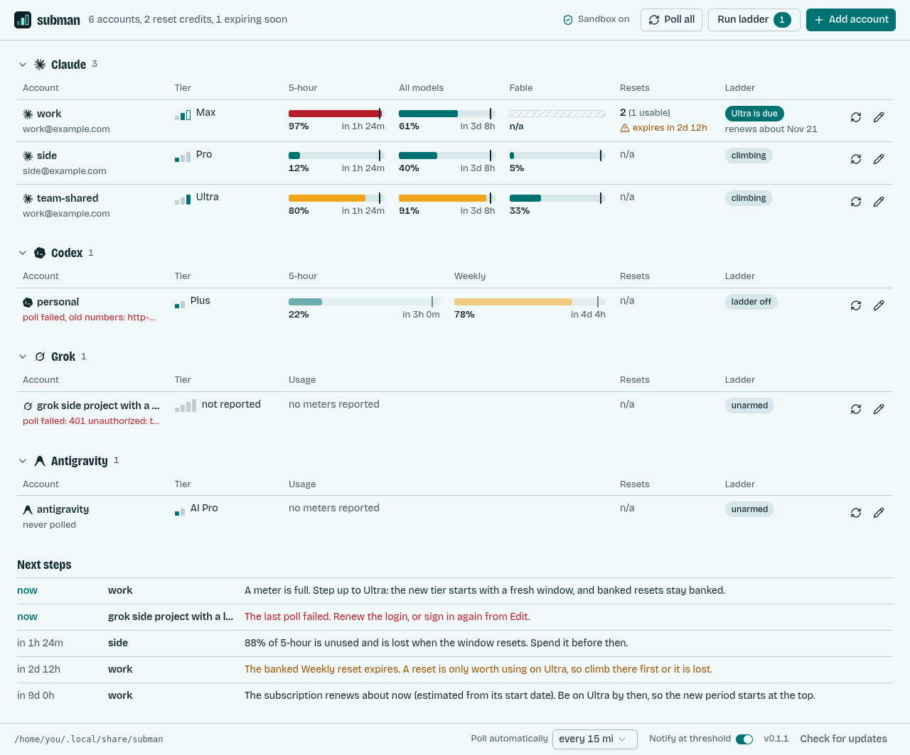
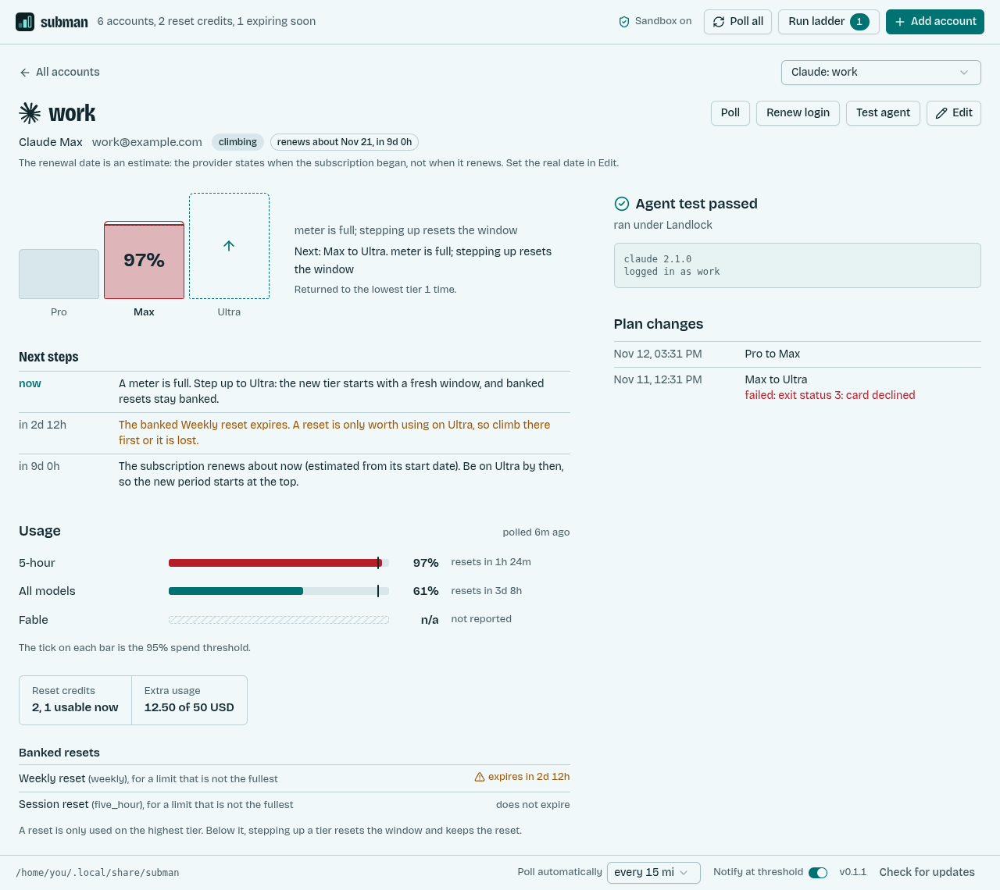
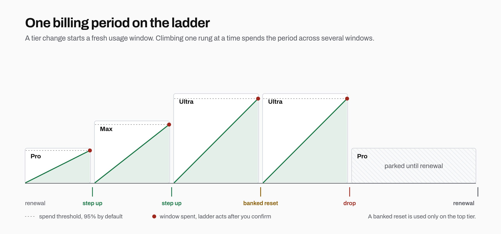

# subman



One window for the Claude, Codex, Grok, and Antigravity subscriptions you already pay for. It shows what each one has left, when it renews, and how many reset credits are banked. When you arm it, it walks a subscription up its paid tiers as each one runs out, then parks at the cheapest tier until the next renewal.





Both pictures are the real window drawn from sample data.

## Why

A tier change resets the usage window. Starting a billing period on the top tier, dropping to the cheapest paid tier, and climbing back up spends one period across several resets instead of one. Doing that by hand across four vendors and several logins is how a reset gets missed. subman keeps the state and only acts when you give it a command that performs the change.



The usage numbers come from the same endpoints the [quota widget](https://github.com/maci0/quota-widget) already polls. Each account holds its own login, separate from the vendor CLI's: subman signs in for it, or copies a file the CLI wrote. It renews that login when it expires and never writes `~/.claude`, `~/.codex`, `~/.grok`, or `~/.gemini`.

## What works

- Sign-in from the window or the command line for Claude, Codex, and Grok, through each provider's own page in your browser. Antigravity takes the file its CLI wrote.
- A board of every account, one foldable table per provider, with a meter per usage window, the time each resets, and the login it is signed in as when the file says.
- Polling when the window opens and on an interval you pick, and a desktop notification (Linux) when an account's fullest meter reaches its spend threshold.
- A failed poll keeps the last good numbers and says they are old. An expired login is renewed on the next poll.
- Ladder: off, unarmed (no change command), climbing, or waiting for renewal. Run ladder lists the plan changes that are due and asks before it runs them, each one is recorded, and a change never repeats on the reading that caused it.
- Next steps at the bottom of the board: what to do with which account and when, to spend every paid window in full (step up, use a reset, drop, spend what is left before a window resets, be on the top tier at renewal).
- Banked resets per account, by type, with a warning when one is about to expire. A reset is only used on the highest tier: below it, stepping up resets the window and keeps the reset. With "Use a banked reset" on, Run ladder lists the reset as a due step and spends it after you confirm. Claude and Codex report banked resets and have a call to use one; Grok and Antigravity report none.
- Test agent: runs `<agent> --version` under Landlock with the account's agent directory as `$HOME`.
- A command line with the same reach: add, set, remove, poll, renew, test, and `ladder run`.
- `subman update` checks GitHub releases and replaces the binary after `SHA256SUMS` matches.

## What does not work yet

No provider documents an API for changing a consumer plan. Claude, Codex, and Grok all do it in a billing page. Until you set a plan-change command on an account, the ladder computes the next step and stops. The command is one executable plus arguments, with `{from}` and `{to}` replaced. It is not a shell.

Sign-in has been run up to each provider's login page, and no further: the approval, the redirect back, and the token exchange have not been exercised with a real account yet. The credential file path is there if one of them fails.

Antigravity quotas come from `agy --print /usage`. That needs `agy` on `PATH` and a signed-in CLI. subman does not sign in to it or renew its token.

Codex states its activation and renewal dates and subman fills them in. Claude states its plan and when the subscription began; the renewal shown for it is an estimate (the next monthly anniversary) and says so, so set the real date in Edit if yours differs. Grok and Antigravity state neither a tier nor a date.

Notifications and the light or dark startup frame are Linux only.

## Install

A tagged push publishes `subman-linux-amd64`, `subman-linux-arm64`, `subman-darwin-amd64`, `subman-darwin-arm64`, `subman-windows-amd64.exe`, and `subman-windows-arm64.exe`, plus `SHA256SUMS`. `subman update` installs the asset for the machine it is running on after the digest matches.

To build it here: Go 1.27.3, bun 1.4.4, and WebKitGTK 4.1. A newer Go is
not what the release is built with: `GOTOOLCHAIN=go1.27.3` selects the
toolchain the `go` line names.

```bash
cd frontend && bun install --frozen-lockfile && bun run build && cd ..
GOTOOLCHAIN=go1.27.3 go build -buildvcs=false -trimpath -buildmode=pie \
  -ldflags "-s -w -X main.version=0.1.1 -linkmode=external -extldflags=-Wl,-z,relro,-z,now" \
  -tags production,webkit2_41 -o subman .
```

## First run

Add an account by picking the provider and signing in: subman opens the provider's own sign-in page in your browser and keeps the login it gets back. That covers Claude, Codex, and Grok. Antigravity has no sign-in here, and any provider can instead take the file its CLI already wrote ("Use a credential file instead", where Browse opens a file dialog):

| Provider | File |
| --- | --- |
| Claude | `~/.claude/.credentials.json` |
| Codex | `~/.codex/auth.json` |
| Grok | `~/.grok/auth.json` |
| Antigravity | `~/.gemini/antigravity-cli/antigravity-oauth-token` |

The window opens on every account in one table per provider and polls a new account as it is added. It polls all of them when it opens and on the interval set in the footer (15 minutes unless changed, or never). It never runs the ladder on its own: Run ladder lists the plan changes that are due and asks first. The tier, and the dates where the provider states them, are filled in from the first poll. Turn the ladder on once a change command exists. When a login can no longer be renewed, use Edit, Sign in again.

```bash
subman --help
subman accounts list
subman accounts add --provider claude                      # prints the sign-in page, then waits
subman accounts add --name agy --provider antigravity --credential ~/.gemini/antigravity-cli/antigravity-oauth-token
subman accounts set <id> --renewal 2026-12-01 --ladder on
subman accounts poll
subman ladder run --dry-run
subman accounts remove <id>
subman update --check
subman schema
```

The command line follows [The CLI Spec v0.3](https://clispec.dev). `--output` is `text` on a terminal and `json` when stdout is a pipe, and an explicit `--output json` wins either way. Data goes to stdout. A failure writes one JSON object to stderr when the format is json, and exits with the code `schema` declares for that error kind: usage 2, not found 4, unavailable 8. `io` and `internal` both exit 1, so a caller that needs to tell them apart reads `error.kind`. `schema` needs no config and no network, and its document validates against `https://clispec.dev/schema/v0.3.json`.

`SUBMAN_UPDATE_REPO` overrides the release repo (`maci0/subman`). `GITHUB_TOKEN` raises the rate limit on the releases API.

## Sandbox

Every child runs under Landlock, the same mechanism gauntlet and microagent use: the agent test, the Antigravity usage poll, and a plan-change command. `/` is read-only and the account directory is the one writable path. `HOME` points there, so a CLI does not write `~/.claude`, `~/.codex`, `~/.grok`, or `~/.gemini`. There is no switch to turn this off. A kernel that will not apply Landlock makes the command fail, and the child is not started. A user namespace is not entered: `unshare(CLONE_NEWUSER)` returns EPERM for a process with no capabilities and `no_new_privs` already set.

## Development

```bash
cd frontend && bun install && bun test && bun run build && cd ..   # first: main.go embeds frontend/dist
go test ./...
vnu --format text frontend/dist/index.html
```

Decisions and what was verified: [docs/PROVENANCE.md](docs/PROVENANCE.md).

## License

MIT. See [LICENSE](LICENSE).

## Disclaimer

Unofficial. Usage endpoints are the ones the vendor CLIs call and can change. Use it with your own accounts.
